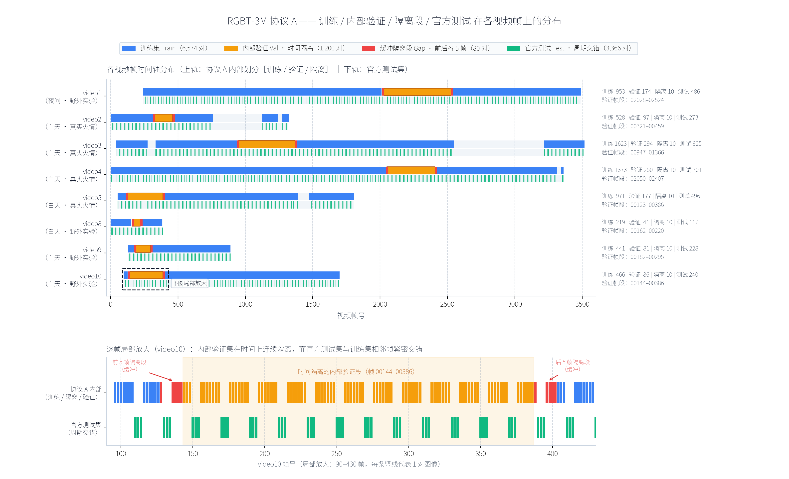

# RGBT-3M 协议 A 探路实验报告与主划分方案

> 本报告汇总 2026-11-23～24 期间完成的 **RGBT-3M 协议 A（官方 7:3 划分 + 内部连续时段隔离验证）** 四组 45-epoch 探路实验结果、细粒度拆解结论，以及据此敲定的数据集主划分方案与后续融合模块设计方向。

---

## 核心结论速览

1. **主划分定案**：确定 **RGBT-3M 协议 A** 作为后续正式实验与消融矩阵（`A0–A5`，100 epoch）的**主实验划分方案**；保留 **协议 B（跨场地 `fire`）** 作为未见场景泛化与抗模态拖累的补充验证。
2. **评估口径规范**：协议 A 的正式论文主表**以官方 `test`（3,366 对）为唯一最终评分集**，必须分项报告整体（AP50 / AP75 / AP50-95）、`fire`、`person`、小目标（`<32²`）及夜间 `video1`；**内部时间隔离 `val`（1,200 对）仅用于训练选模、收敛监控与先导问题诊断，不列入正式主表**，以避免选模偏差。
3. **关键发现**：
   - **未饱和、双流增益显著**：官方 `test` 上 `concat_1to1` 相比单模态提升 **+3.3～+5.4 pt**（COCO AP50-95），远未触及 95% 天花板。
   - **官方 `test` 上 `2:1` 整体仅低 `0.27 pt` 的本质是“类别与场景正负抵消”**：在依赖红外细粒度定位的场景（夜间 `video1` fire **-3.12**、`video5` fire **-3.27**、野外实验 fire **-2.84**、超小火焰 **-1.27**、小人员 **-1.47**）存在明确退化；在 RGB 主导、目标偏大或存在局部配准残差的场景（`video8` person **+6.37**、`video4` fire **+1.78**）中，IR 降采样反而平滑了错位噪声、扩大了感受野，拉高了总分。
   - **跨分辨率的核心瓶颈是高 IoU 精确定位退化**：在去除相邻帧记忆的内部时间隔离 `val` 上，`2:1` 的 AP50 几乎未降，但 **AP75 断崖下跌**（整体 **-4.4 pt**，夜间 `video1` **-16.9 pt**），`fire` AP50-95 下降 **-2.57 pt**，小火焰（`16²–32²`）下降 **-6.29 pt**。
   - **直接拼接存在“模态拖累”**：强 IR 视频（`video1/2/10` fire）中纯 `ir` 高于直接 `concat`，强 RGB 片段（`val` `video2/3` person）中纯 `rgb` 高于直接 `concat`。
4. **模块设计闭环**：上述三类实证现象直接指向论文双核心模块——**多感受野跨分辨率特征适配（Adapter）**（补齐精确定位并兼容轻度错位）+ **通道/空间自适应门控与模态随机失活（Modality Dropout）**（抑制弱模态拖累）。

---

## 一、协议 A 数据划分方案（RGBT-3M 主划分）

### 1.1 划分原则与防泄露设计

- **完整保留官方最终评分集**：RGBT-3M 官方 `val.txt` 的 **3,366 对**图像原样保留为协议 A 的 `test.txt`，全程**不参与训练、调参或最佳权重选择**，保证与 RGBT-3M 原论文完全同口径。
- **官方训练集内部做连续时段验证 + 缓冲隔离**：从官方 `train.txt` 的 **7,854 对**中划出 **6,574 对训练、1,200 对内部验证、80 对隔离**（剔除隔离段后训练/验证比例为 **84.56% / 15.44%**）。8 条视频各取一个连续时间窗口作为内部 `val`，前后各留出 5 对紧邻的官方训练图像作为 `gap` 缓冲，避免内部选模受相邻帧泄露影响。
- **分布对齐**：各视频内部验证名额按官方训练池比例分配，兼顾 `fire`、`person`、无目标帧和火焰框尺度。真实火情（`video2–5`）的火焰框在训练/验证中分别占 **68.65% / 68.40%**，人员框占 **27.67% / 27.49%**，无目标帧占 **22.62% / 17.92%**。

> 完整清单文件与逐对说明见：[splits/rgbt3m_protocol_a/README.md](../splits/rgbt3m_protocol_a/README.md)

### 1.2 各视频帧分布图

**图示说明**：
- **数据来源**：`splits/rgbt3m_protocol_a/`（合计覆盖原版全部 **11,220 对**图像，四份清单两两互斥）。
- **上半图（全 8 条视频时间轴）**：每条视频分上下两轨——**上轨**是协议 A 从官方 `train.txt` 切出的 `Train`（蓝）、连续时间窗口 `Internal Val`（橙）及前后各 5 对 `Gap` 缓冲段（红）；**下轨**是原样保留的官方 `Test`（绿，即原论文 `val.txt`）。右侧标出每条视频的样本计数与内部 `Val` 帧号区间。
- **下半图（`video10` 第 90–430 帧局部放大）**：可以直观看到**官方 `Test`（绿）按周期交错穿插在 `Train`（蓝）之间**（存在同视频紧邻帧），而**内部 `Val`（橙，帧 `00144–00386`）是一整段连续时间窗口**，两端各由 5 对 `Gap`（红）与 `Train` 彻底隔开。

### 1.3 数据集统计汇总

| 用途 | 清单文件 | 图像对 | `fire` 框 | 小火焰 `<32²` 框 | `person` 框 | 无目标帧 | 说明 |
|---|---|---:|---:|---:|---:|---:|---|
| 训练集 | `splits/rgbt3m_protocol_a/train.txt` | 6,574 | 6,631 | 4,675 | 3,451 | 1,487 | 来自官方 `train.txt` |
| 内部验证 | `splits/rgbt3m_protocol_a/val.txt` | 1,200 | 1,209 | 894 | 633 | 215 | 8 条视频各取连续时段，仅用于选模与诊断 |
| 隔离缓冲 | `splits/rgbt3m_protocol_a/gap.txt` | 80 | 73 | — | 64 | 10 | 每个验证段前后各隔 5 对，不参与训练和评估 |
| 官方最终评分 | `splits/rgbt3m_protocol_a/test.txt` | 3,366 | 3,401 | 2,447 | 1,739 | 754 | 原论文 `val.txt` 完整保留，仅最终报分 |

| 视频 | 场景与昼夜 | 训练对数 | 内部验证帧号 | 验证对数 | 隔离帧号（10 对/条） | 官方 Test 对数 |
|---|---|---:|---|---:|---|---:|
| `video1` | 夜间 · 野外实验 | 953 | `02028–02524` | 174 | `02012–02026`、`02526–02540` | 486 |
| `video2` | 白天 · 真实火情 | 528 | `00321–00459` | 97 | `00316–00320`、`00460–00467` | 273 |
| `video3` | 白天 · 真实火情 | 1,623 | `00947–01366` | 294 | `00939–00946`、`01367–01374` | 825 |
| `video4` | 白天 · 真实火情 | 1,373 | `02050–02407` | 250 | `02045–02049`、`02408–02415` | 701 |
| `video5` | 白天 · 真实火情 | 971 | `00123–00386` | 177 | `00115–00119`、`00387–00391` | 496 |
| `video8` | 白天 · 野外实验 | 219 | `00162–00220` | 41 | `00157–00161`、`00221–00228` | 117 |
| `video9` | 白天 · 野外实验 | 441 | `00182–00295` | 81 | `00174–00178`、`00296–00303` | 228 |
| `video10` | 白天 · 野外实验 | 466 | `00144–00386` | 86 | `00128–00142`、`00388–00402` | 240 |

### 1.4 协议定位与双协议分工

| 协议 | 评估对象 | 类别 | 在论文中的角色 |
|---|---|---|---|
| **协议 A（主划分）** | 官方 `test`（3,366 对，分项报分） | `fire` + `person` | 主实验对比表、完整消融矩阵（`A0–A5`）、昼夜/尺度拆解、与原论文同口径对标 |
| **协议 B（泛化补充）** | 跨场地独立 `test`（`video2` 真实火情 + `video8/9` 野外实验，共 2,055 对） | `fire` | 检验去相邻帧记忆后的跨视频泛化能力与抗模态拖累效果 |

---

## 二、本轮四组探路模型与统一训练配置

本轮探路运行目录：`runs/orchestration/rgbt3m_protocol_a_20261123_e45_raw_ir`（按仓库规范不上传大权重与输出目录，仅记录配置与指标）。

### 2.1 四组对照模型

| 模型名 | 配置文件 | 输入模式 | RGB 分辨率 | IR 分辨率 | 分辨率比例 | 最佳轮次（内部 `val`） | 45 轮训练耗时 |
|---|---|---|---:|---:|---:|---:|---:|
| `rgb` | `configs/yolov8n_dual_concat.yaml` | `rgb_input` | 480×640 | — | 1∶1 | ep39 | ~60.0 min |
| `ir` | `configs/yolov8n_dual_concat.yaml` | `ir_input` | — | 480×640 | 1∶1 | ep37 | ~56.8 min |
| `concat_1to1` | `configs/yolov8n_dual_concat.yaml` | `dual_input` | 480×640 | 480×640 | 1∶1 | ep32 | ~61.5 min |
| `concat_2to1` | `configs/yolov8n_dual_concat_ratio2.yaml` | `dual_input` | 480×640 | 240×320 | 2∶1 | ep40 | ~57.6 min |

### 2.2 统一训练与评估配方

- **骨干初始化**：基于 YOLOv8n COCO 预训练权重向 RGB/IR 双流骨干及共享 SPPF 迁移初始化（`rgb` 1,112,329 元素、`ir` 1,112,329 元素、`shared_sppf` 165,378 元素）。
- **优化与调度**：45 epoch、`seed=0`、`AdamW`、`lr0=0.001`、`lrf=0.01`、余弦学习率（`cos_lr=True`）、3 epoch warmup、`batch=16`、`nbs=64`、`weight_decay=0.0005`、AMP 混合精度。
- **损失与增强**：`box=7.5`、`cls=0.5`、`dfl=1.5`；`mosaic=1.0`（末 10 轮关闭）、轻微几何与颜色抖动（`degrees=8.0`、`translate=0.05`、`scale=0.15`、`fliplr=0.5`、`flipud=0.1`、`hsv_h=0.005`）。
- **跨分辨率与数据细节**：2∶1 IR 采用单次 `area` 降采样至 `240×320`；保留 `video1/10` 原始红外水印（`watermark=original`，`masked_images=0`）。
- **选模规则**：每轮在内部 `val`（1,200 对）评估，按 **内部验证 AP50-95** 保存 `best.pt`；训练结束后用 `best.pt` 在官方 `test`（3,366 对）独立评测一次。

---

## 三、官方 `test`（3,366 对）评估结果与关键发现

### 3.1 总览表（Ultralytics 验证器口径，`evaluation_metrics.json`）

| 模型 | Precision | Recall | Overall AP50 | Overall AP50-95 | `fire` AP50 / AP50-95 | `person` AP50 / AP50-95 | 小火焰 `<32²` AP50 / AP50-95 |
|---|---:|---:|---:|---:|---:|---:|---:|
| `rgb` | 87.19 | 83.66 | 87.36 | 44.62 | 85.02 / 40.81 | 89.70 / 48.42 | 83.69 / 39.39 |
| `ir` | 87.99 | 83.03 | 88.20 | 46.58 | 85.01 / 45.40 | 91.39 / 47.76 | 80.56 / 42.30 |
| `concat_1to1` | **89.73** | 88.68 | **92.82** | **50.68** | **91.10 / 49.92** | **94.55** / 51.45 | **88.31** / 45.94 |
| `concat_2to1` | 89.09 | **88.71** | 91.78 | 50.40 | 89.59 / 48.52 | 93.97 / **52.27** | 87.47 / **46.23** |

> **口径说明**：上表 Overall/`fire`/`person` 来自 Ultralytics 验证器，小火焰 `<32²` 来自 `pycocotools` COCOeval（每图每类最多 100 框）。下文 3.2 与第四节统一使用 `pycocotools` COCOeval 口径对全部子集拆解，与上表存在 ~0.6–1.4 pt 的固定口径差，但四组相对趋势完全一致。

### 3.2 分场景、分类别与分尺度细粒度拆解（COCOeval 统一口径）

#### （1）官方 `test` 分场景 & 分类别（COCO AP50 / AP50-95）

| 分组 | 类别 | GT 数 | `rgb` | `ir` | `concat_1to1` | `concat_2to1` | `2:1 − 1:1` (AP50-95) |
|---|---|---:|---:|---:|---:|---:|---:|
| **ALL** | 整体 | 5,140 | 86.7 / 43.93 | 87.7 / 45.95 | **91.9 / 49.28** | 91.0 / 49.01 | **-0.27** |
| **ALL** | `fire` | 3,401 | 84.2 / 40.15 | 84.4 / 44.83 | **89.8 / 48.10** | 88.5 / 46.87 | **-1.23** |
| **ALL** | `person` | 1,739 | 89.1 / 47.70 | 91.0 / 47.06 | 94.0 / 50.45 | **93.4 / 51.15** | **+0.69** |
| **白天（非 `v1`）** | `fire` | 2,915 | 81.6 / 38.18 | 81.1 / 41.31 | **87.8 / 45.48** | 86.7 / 44.57 | **-0.90** |
| **夜间 `video1`** | `fire` | 486 | 98.5 / 51.62 | **100.0 / 63.73** | 100.0 / 62.39 | 97.7 / 59.27 | **-3.12** |
| **野外实验 `v1,8–10`** | `fire` | 1,071 | 94.8 / 46.30 | **98.5 / 59.55** | 98.7 / 58.39 | 97.6 / 55.55 | **-2.84** |
| **真实火情 `video5`** | `fire` | 836 | 71.4 / 33.97 | 82.7 / 41.83 | **84.3 / 44.50** | 79.2 / 41.23 | **-3.27** |
| **真实火情 `video4`** | `fire` | 709 | 79.8 / 41.92 | 71.4 / 36.88 | 83.7 / 43.84 | **84.3 / 45.62** | **+1.78** |
| **野外实验 `video8`** | `person` | 97 | 95.5 / 59.34 | 96.4 / 54.38 | 98.0 / 55.57 | **97.9 / 61.94** | **+6.37** |

#### （2）官方 `test` 按目标面积分档（RGB `640×480` 坐标系，COCO AP50 / AP50-95）

| 类别 | 尺度档 | GT 数 | `rgb` | `ir` | `concat_1to1` | `concat_2to1` | `2:1 − 1:1` (AP50-95) |
|---|---|---:|---:|---:|---:|---:|---:|
| `fire` | 超小 `<16²` | 1,017 | 74.7 / 32.20 | 62.7 / 28.59 | **79.5 / 36.67** | 78.0 / 35.40 | **-1.27** |
| `fire` | 小 `16²–32²` | 1,430 | 90.0 / 44.58 | 92.1 / 51.78 | 94.7 / 52.51 | **94.1 / 53.53** | +1.02 |
| `fire` | 中 `32²–96²` | 942 | 88.0 / 43.99 | 94.2 / 51.90 | **94.6 / 53.81** | 95.5 / 52.72 | **-1.09** |
| `person` | 超小 `<16²` | 464 | 80.3 / 31.36 | 76.5 / 29.48 | **83.8 / 36.87** | 85.2 / 35.34 | **-1.53** |
| `person` | 全部小 `<32²` | 1,025 | 85.5 / 37.28 | 85.3 / 37.49 | **90.2 / 42.96** | 89.9 / 41.50 | **-1.47** |
| `person` | 中 `32²–96²` | 691 | 95.1 / 60.26 | 97.9 / 58.30 | 98.4 / 60.00 | **98.1 / 62.21** | **+2.21** |

### 3.3 两个核心发现

1. **为什么 `2:1` 整体只比 `1:1` 低 `0.27 pt`？——被类别与场景“一正一负抵消”**
   - **退化端（红外细粒度定位主导）**：夜间 `video1` fire（**-3.12**）、野外实验 fire（**-2.84**）、`video5` fire（**-3.27**）、超小火焰 `<16²`（**-1.27**）、小人员 `<32²`（**-1.47**）均出现明确掉点。
   - **反超端（RGB 主导 / 目标偏大 / 存在局部配准残差）**：`video8` 人员（**+6.37**）、中型人员（**+2.21**）、含局部错位的 `video4` fire（**+1.78**）中，IR 降采样一半反而弱化了局部配准噪声并扩大了等效感受野，把总分拉回。
   - **启示**：论文主表**绝不能只报官方 `test` 总分**，必须把整体、AP75、`fire`/`person`、小目标和夜间 `video1` 分列出来。
2. **直接拼接存在明显的“模态拖累”**
   - 在强红外场景中，直接 `concat` 反而不如纯 `ir`：`video1` 夜间 fire（纯 `ir` **63.73** > `1:1` 62.39 > `2:1` 59.27）、`video2` fire（纯 `ir` **61.52** > `1:1` 56.63）、`video10` fire（纯 `ir` **66.54** > `1:1` 64.16）。
   - 这与协议 B 跨场地 `video2` 的观察完全一致，说明弱模态噪声会直接拉低强模态特征的定位精度。

---

## 四、训练期诊断分析（内部时间隔离 `val`，仅作动机与收敛参考）

> **方法学说明**：内部 `val`（1,200 对）在训练期用于选择 `best.pt`，存在选模偏差，**不作为论文最终测试结论**；本节仅用于观察训练收敛特性，以及在去除同视频相邻帧记忆后定位退化的诊断现象。

### 4.1 训练收敛状态（45 epoch，`results.csv`）

| 模型 | 最佳轮次 | 最佳 AP50 / AP50-95 | ep45 AP50 / AP50-95 | 后 10 轮 AP50-95（均值 ± 标准差） | ep10 → 20 → 30 → 40 → 45 |
|---|---:|---:|---:|---:|---|
| `rgb` | 39 | 69.81 / 28.07 | 68.23 / 27.42 | 27.42 ± 0.47 | 20.4 → 24.7 → 25.2 → 27.7 → 27.4 |
| `ir` | 37 | 69.27 / 31.33 | 68.17 / 30.71 | 30.73 ± 0.40 | 27.0 → 27.0 → 30.0 → 30.0 → 30.7 |
| `concat_1to1` | 32 | 76.62 / **37.32** | 77.14 / **37.08** | **36.48 ± 0.49** | 31.8 → 35.0 → 35.3 → 36.7 → 37.1 |
| `concat_2to1` | 40 | 78.96 / 36.70 | 78.82 / 36.09 | 35.69 ± 0.70 | 28.7 → 30.2 → 33.5 → 36.7 → 36.1 |

- 45 轮已基本进入平台期，但 `concat_2to1` 前 30 轮收敛显著更慢（ep20 落后 `1:1` 达 **4.8 pt**），后 10 轮均值低 **-0.79 pt** 且波动更大（std `0.70` vs `0.49`）。

### 4.2 时间隔离下的高 IoU 定位退化（COCOeval 口径）

官方 `test` 与训练集包含同视频相邻帧，四组模型在 `test` 上的 AP50-95 普遍比时间隔离 `val` 高 **13–17 pt**。一旦去掉相邻帧场景记忆，2∶1 跨分辨率在**高 IoU（AP75）与火情小目标**上的定位瓶颈非常突出：

| `val` 分组 | 类别 | `rgb` | `ir` | `concat_1to1` | `concat_2to1` | `2:1 − 1:1` (AP50-95) |
|---|---|---:|---:|---:|---:|---:|
| **ALL**（AP50 / **AP75** / AP50-95） | 整体 | 69.5 / 15.8 / 27.49 | 68.6 / 22.5 / 30.66 | 74.9 / **28.9** / **35.94** | 77.5 / **24.5** / 35.28 | **-0.67**（AP75 **-4.4**） |
| **ALL** | `fire` | 55.9 / 19.82 | 58.5 / 30.15 | **63.4 / 32.55** | 65.3 / 29.98 | **-2.57** |
| **夜间 `video1`** | 整体 | 88.9 / 38.47 | 98.6 / 53.50 | **98.6 / 56.96** | 97.5 / 50.59 | **-6.37**（AP75 **-16.9**） |
| **夜间 `video1`** | `fire` | 93.6 / 41.81 | 99.9 / 60.64 | **97.5 / 60.65** | 98.0 / 52.55 | **-8.10** |
| **野外实验 `v1,8–10`** | `fire` | 92.0 / 34.06 | 98.6 / 58.82 | **97.2 / 58.10** | 96.7 / 49.18 | **-8.92** |
| **真实火情 `video2`** | `fire` | 96.3 / 32.89 | 100.0 / 57.89 | **100.0 / 57.82** | 100.0 / 48.82 | **-9.01** |
| **小火焰 `<32²`（`16²–32²`）** | `fire` | 57.0 / 20.41 | 50.5 / 25.68 | **61.8 / 31.16**（44.10） | 62.1 / 28.14（37.81） | **-3.02**（**-6.29**） |

- **核心诊断结论**：`2:1` 在 `val` 上 **AP50 没掉甚至略高，但 AP75 断崖下跌**（整体 **-4.4 pt**，夜间 `video1` 从 `60.1` 跌至 `43.2`，**-16.9 pt**），说明 2∶1 跨分辨率不是“完全看不到目标”，而是**边界与精确定位能力明显受损**。

---

## 五、对融合模块设计与下一步实验的指导

### 5.1 从分项现象出发设计跨分辨率融合模块

| 探路分项暴露的实证现象 | 对应的融合模块设计出发点 |
|---|---|
| **高 IoU（AP75）断崖下跌**（夜间 `video1`、小火焰 `<32²`） | IR 2∶1 降采样导致高频边界与亚像素空间精度丢失 → **跨分辨率特征适配（Adapter）**重点补齐空间对齐与浅层 P3 细节恢复 |
| **大目标/轻度错位场景下 2∶1 反而略优**（`video4`、`video8`） | 不同区域对感受野和配准残差的容忍度不同 → Adapter 保留**多感受野分支**（小卷积核保精定位 + 大感受野/空洞分支抗轻度错位） |
| **强单模态视频中被弱模态拖累**（强 IR 场景纯 IR 更强、强 RGB 场景纯 RGB 更强） | 直接 `concat` 无法按空间位置抑制噪声模态 → **通道 + 空间自适应门控**配合训练期**模态随机失活（Modality Dropout）**，按位置动态调节 RGB/IR 权重 |

### 5.2 下一步实验安排

1. **补齐 DroneVehicle 对照（优先，约 2 小时）**：在 `dronevehicle_crossres_pilot_20261123` 中补跑 `concat_2to1`（30 轮），与已完成的 `ir`（55.91）和 `concat_1to1`（61.95）对比 2∶1 退化幅度，最终确认“RGBT-3M 主、DroneVehicle 辅”的分工。
2. **审视并定型跨分辨率融合模块**：对照第 5.1 节三个设计出发点检查当前 `adapter` 与 `gated` 模块实现，确认无结构短板后冻结模型代码。
3. **运行协议 A 正式消融矩阵（100 epoch）**：固定协议 A 划分与统一训练配方，运行 `A0`（2∶1 直接拼接）→ `A1`（+Adapter）→ `A2`（+通道门控）→ `A3`（+空间门控）→ `A4/A5`（辅助损失/模态失活对照），在官方 `test` 上输出完整分项表。
4. **泛化与压力测试补充**：在 **协议 B（跨场地 `fire`）** 上验证最终模型对未见场景和模态拖累的改善；模型定型后可选在协议 A 上补跑 **4∶1（IR `160×120`）或配准错位压力测试**，进一步验证跨分辨率鲁棒性。
